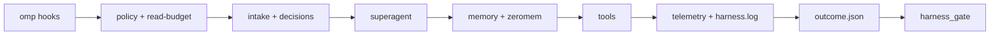
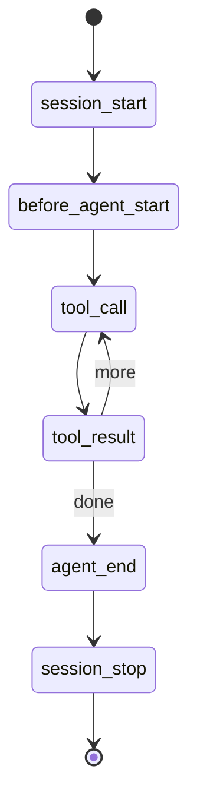
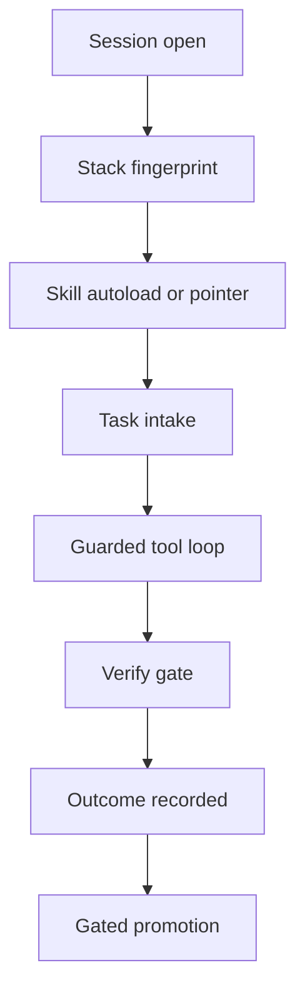
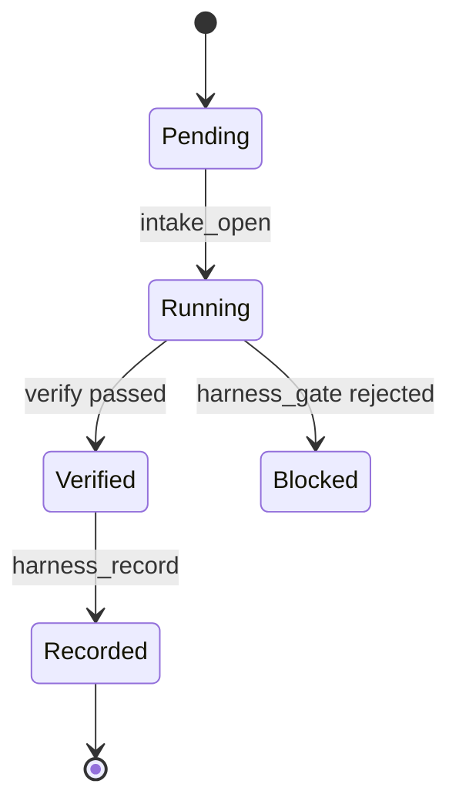
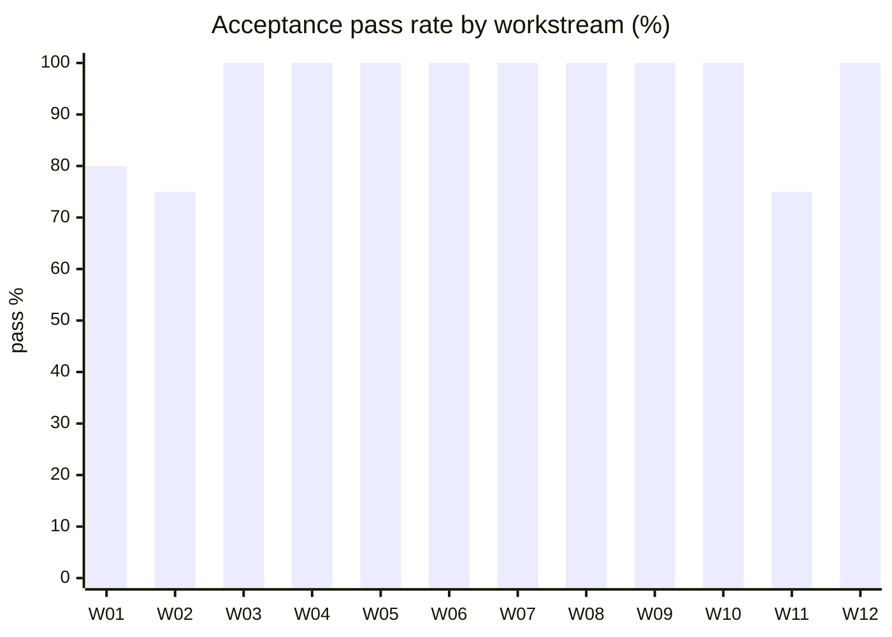
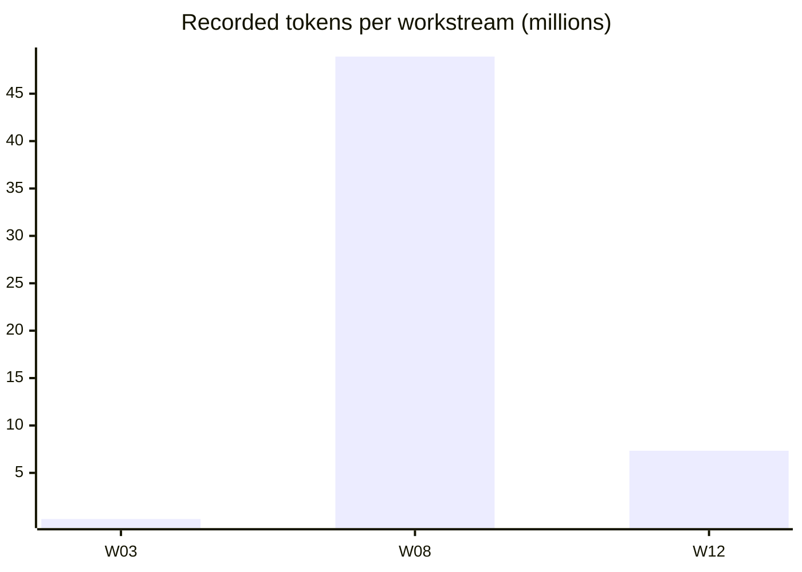
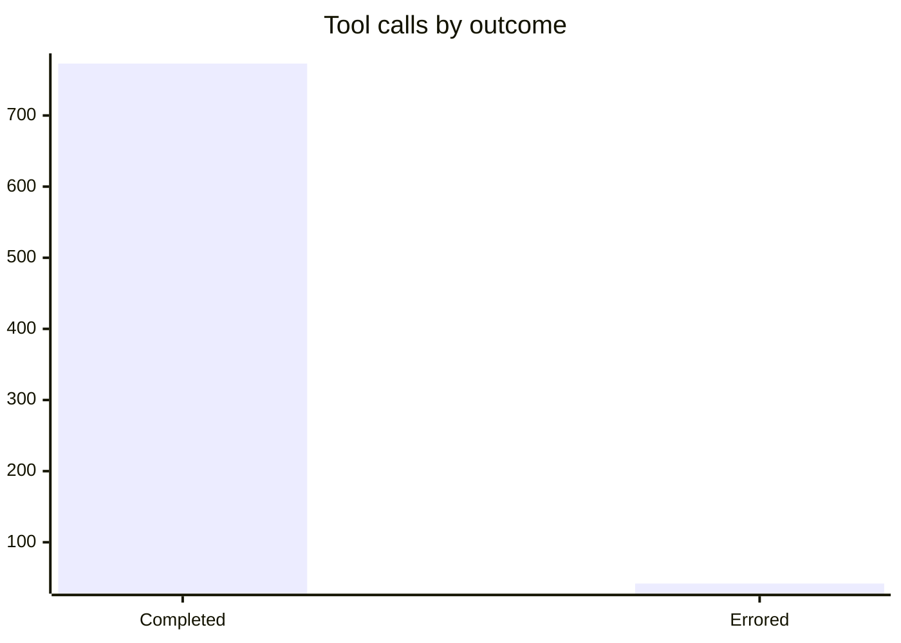
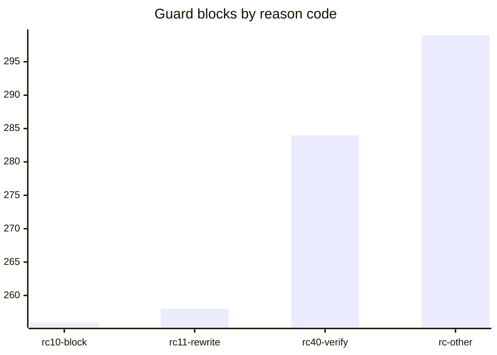
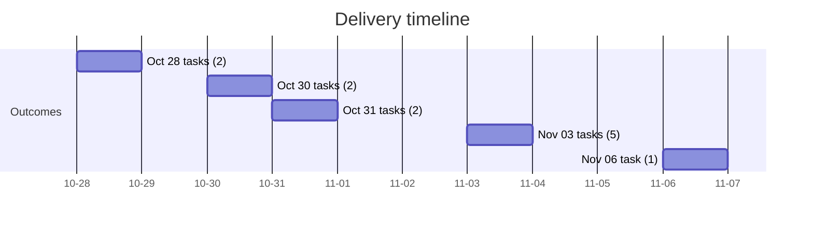

# @local/omp-adaptive-harness

`@local/omp-adaptive-harness` is a versioned, evidence-driven harness plugin for stock omp. It adds deterministic tool policy and guardrails, a read-budget guard, session telemetry, optional bounded shadow Jev decisions, a closed-valve skill router, per-project Zero-Mem memory, superagent workflow supervision, and gated learning through structured task outcomes. It adds no agent runtime and installs no third-party plugin.

Compatible with omp `>= 18.12.6` (tested on `18.12.6`, `18.13.1`, `18.14.0`, `18.16.0`, `18.17.0`), Node `>= 24`.

## Usage

Practical commands, copy-pasteable.

### Requirements and install

- omp `>= 18.12.6`, Node `>= 24`.
- Clone the public repo, then link it into omp:

```text
git clone --recurse-submodules https://github.com/TienDat11/omp-harness-plugin.git
omp plugin link <repo-path>
```

If you cloned without --recurse-submodules, run `git submodule update --init --recursive` — the Python bridge loads `vendor/zero-mem`, while the in-process `src/zeromem.ts` engine does not need it.

- Development load with an isolated profile (default profile untouched):

```text
omp --profile omp-harness-probe-<runId>-candidate --extension D:\omp-harness
```

- Adopt user-wide:

```text
omp plugin link D:\omp-harness
```

- Rollback:

```text
omp plugin uninstall @local/omp-adaptive-harness
```

After adoption, start a NEW session and confirm `/extensions`, `/agents`, `/advisor status`, and `omp config list`. Back up the existing user `AGENTS.md`, custom agent files, and skill versions into a timestamped backup outside the target project before installation. Never patch `omp.exe` or installed package code as part of this harness.

### Verify, probes, and compare

```text
node scripts/verify.mjs --omp-version <version> --config config/recommended.yml
node scripts/run-probes.mjs --split all --repeats 2 --profile-prefix omp-harness-probe-<runId>
node scripts/compare.mjs --baseline probes/baseline.json --candidate probes/results-<runId>.json
npm test        # node --test
npm run verify  # node scripts/verify.mjs
npm run probes  # node scripts/run-probes.mjs
npm run compare # node scripts/compare.mjs
```

`verify` checks the manifest schema, entrypoints, checksums, version gate, config overlay keys, no credentials, and agent frontmatter. Exit codes: `verify` `0` ok / `1` check failed / `2` run error; `compare` `0` valid improvement / `1` valid non-improvement / `2` inconclusive or missing data. Probes run only in isolated profiles and never touch the default profile.

### Slash commands and tools

| Surface | Purpose |
|---|---|
| `/harness-decision status|allow-input|off|probe` | Controls Jev egress per session; `probe` unlocks a non-default host with one synthetic round-trip. |
| `/harness-stack` | Prints the session stack fingerprint from `src/stack-router.ts`. |
| `/harness-log` | Prints a compact summary of the global harness log. |
| `/zero-mem status|sync|recall|save` | Zero-Mem memory operations. |
| `/skill-rate`, `/harness-skill`, `/harness-lesson`, `/superagent` | Skill lift override, skill picker, lesson gate, superagent supervision. |
| `harness_record` | Writes `outcome.json` with tier, goal, per-acceptance pass/fail and joint, models, tokens, wall time. |
| `harness_mine` | Mines failed acceptance entries from every `outcome.json` under `.omp/work`. |
| `harness_gate` | Applies the admission rule (in-sample and held-out deltas); accepted edits append to `accepted.jsonl`, rejected to `rejected.jsonl`. |
| `harness_decide` | Calls the TypeSafe Jev endpoint for intake/requirement/priority; `readiness` is local. |
| `intake_open` | Creates the tier-M/L/XL task folder `.omp/work/<date>/<slug>/` with `00-requirement.md`. |
| `zero_mem_recall`, `zero_mem_save`, `zero_mem_ask` | Zero-LLM recall, zero-LLM write, paid-reader question. |

### Config overlay and environment

Apply the documented settings overlay (`config/recommended.yml` covers task routing, advisor off, edit hashline, read limit, bash interceptor, model loop guard, compaction, provider append-only context, cache retention) over `~/.omp/agent/config.yml`. The overlay changes routing and guardrail policy only, never provider credentials.

| Variable | Effect |
|---|---|
| `OMP_HARNESS_JEV` | Off by default; `1` enables shadow-only Jev. One request per task boundary, no retries, 5 s timeout. |
| `OMP_HARNESS_LOG_PATH` | Overrides `~/.omp/harness/harness.log`. |
| `TYPESAFE_BASE_URL` | Alternative endpoint, e.g. `https://api.ns24.io` with `jev-latest` over the same `systemOne` dialect. |
| `OMP_HARNESS_JEV_MODEL` | Overrides the Jev model name; must match what the endpoint reports or the call fails with `model-mismatch`. |
| `OMP_HARNESS_REPO_SKILLS` | Adds repo-local skills to the router catalog. |

### Repository layout

```text
omp-harness/
├── src/                 policy, read-budget, intake, tools, decisions, telemetry,
│                        state, verify-gate, stack-router, memory, zeromem,
│                        superagent, skill-specs, skill-telemetry
├── agents/              coder.md, harness-grader.md
├── skills/              omp-harness, omp-superagent, harness-loop, task-intake,
│                        product-delivery, karpathy-guidelines
├── config/              recommended.yml (settings overlay)
├── scripts/             verify.mjs, run-probes.mjs, compare.mjs,
│                        migrate-memory.mjs, benchmark-compare.mjs
├── vendor/zero-mem/     git submodule -> github.com/Zero-Mem/Zero-mem (bridge source)
├── probes/              (local only, gitignored) probe definitions, fixtures, baseline, per-run results
├── tests/               14 *.test.ts files (node --test)
├── harness.manifest.json
└── README.md
```

## Architecture

### Hook to artifact pipeline



Entrypoints (from `package.json` `omp.extensions` and `harness.manifest.json`): `src/policy.ts`, `src/intake.ts`, `src/tools.ts`, `src/memory.ts`, `src/verify-gate.ts`, `src/stack-router.ts`, `src/superagent.ts`. `src/state.ts` is a library and is NOT an entrypoint.

### Module table

| Module | Hook | Purpose | Artifact written |
|---|---|---|---|
| `policy` (`src/policy.ts`) | `tool_call`, `tool_result`, `session_shutdown` | Tool-call policy: secret-file access, destructive bash, repeated-failure dedup, telemetry. | `~/.omp/harness/harness.log` (`E1`, `G1` codes). |
| `read-budget` (`src/read-budget.ts`) | `tool_call` | Narrows any explicit range to 180 lines, refuses live duplicate reads, injects `<parent-read-ledger>` into `task` calls. | In-context ledger text; `G1 rc=10` / `rc=11` log lines. |
| `intake` (`src/intake.ts`) | `session_start`, `/harness-decision` | Intake classification with shadow Jev advisory. | `.omp/work/<date>/<task>/00-requirement.md` via `intake_open`. |
| `tools` (`src/tools.ts`) | tool surface | `harness_record`, `harness_mine`, `harness_gate`, `harness_decide`, `intake_open` plus session commands. | `outcome.json`; `.omp/harness/decisions.jsonl`, `accepted.jsonl`, `rejected.jsonl`. |
| `decisions` (`src/decisions.ts`) | on demand | Optional bounded TypeSafe Jev decision layer; `readiness` is pure local. | `.omp/harness/jev-decisions.jsonl`. |
| `telemetry` (`src/telemetry.ts`) | `tool_result`, `agent_end` | Read-only aggregation of omp session JSONL v3 and `M1` turn-end rows. | `.omp/harness/telemetry.jsonl`, `telemetry-totals`. |
| `state` (`src/state.ts`) | library | Session-local mutable state. | None (in memory). |
| `verify-gate` (`src/verify-gate.ts`) | `session_stop` | Advisory gate: a turn that wrote files and ran no check afterwards gets one continuation asking for real verification, capped at 3 per session. A check that ran and failed still counts. | `G1 rc=40` / `rc=41` log lines. |
| `stack-router` (`src/stack-router.ts`) | `session_start`, `before_agent_start`, `/harness-stack` | Detects the repo stack once per session from `package.json` / `pyproject.toml` / `go.mod` / `Cargo.toml` / markers; names installed domain skills in one cache-safe `harness-stack` message. | `S1` log lines; `harness-stack` custom message. |
| `memory` (`src/memory.ts`) | `before_agent_start`, `agent_end` | Zero-Mem wiring: Jev-gated recall/write, cache-safe `BeforeAgentStartEventResult.message` (`customType: "zero-mem-recall"`, `display: false`); `zero_mem_recall` / `zero_mem_save` / `zero_mem_ask`, `/zero-mem`. | `.omp/memory/zero-mem/<dataset>/`. |
| `zeromem` (`src/zeromem.ts`) | engine | In-process `node:sqlite` (`DatabaseSync`) + WAL + FTS5 BM25 (`bm25RankToScore`) + L0/L1/L2 + File/Symbol code-graph; Jev-gated recall/write. | SQLite store under `.omp/memory/zero-mem/<dataset>/`. |
| `superagent` (`src/superagent.ts`) | `tool_result`, `session_shutdown` | Worker supervision: report classification, edit-thrash and scope guard, waits-for-person detection. | `W1` / `W2` log lines; `G1 rc=30` / `rc=31` / `rc=34`. |

The skill router inside `stack-router` is closed-valve: pointer-only by default and autoloads at most one skill per turn only when the top score is at least `AUTOLOAD_THETA` (0.7), the margin over the runner-up is at least `AUTOLOAD_MARGIN` (0.15), the skill is allowlisted with a pinned `SKILL.md` sha256, an offline L1 digest of at most 4000 chars exists, the turn is not a 15% random holdout, and the skill was not already injected this session. A MiniSearch funnel (top 25 of a 105-skill catalog) feeds IDF-weighted `scoreSkillDocs` scoring with `SCORE_DECAY = 8`; refusal returns a pointer (`skill://<name>`) with a reason such as `below-theta` or `thin-margin`. Lift telemetry is shadow-mode until `MIN_SHADOW_SAMPLES = 20` runs, with lift clamped to +/-0.2.

### Turn lifecycle



| Hook point | What the harness does |
|---|---|
| `session_start` | `stack-router` derives the fingerprint (bounded to 4000 directory entries); `state` initialises session-local state; `intake` classifies the task and opens the tier folder. |
| `before_agent_start` | `stack-router` appends one `harness-stack` message on the first turn; the closed-valve router may autoload at most one skill (logs `S1`); `memory` decides recall with Jev (`memory-recall`) or deterministic fallback, capped at 5 units / 2,400 chars. |
| `tool_call` | `policy` blocks secret files and destructive bash, dedups repeated failures; `read-budget` narrows ranges over 180 lines, refuses live duplicate reads, and appends `<parent-read-ledger>` to `task` calls. |
| `tool_result` | `policy` logs `E1` errors; `superagent` classifies worker reports (`W1`) and watchdog alerts (`W2`); `telemetry` appends to `telemetry.jsonl`; `verify-gate` counts mutations vs checks. |
| `agent_end` | `telemetry` logs `M1` (mutations, calls, errors, verify passed, reward); `memory` asks Jev (`memory-write`, durable AND not already known) and appends deterministic verbatim units; episodes channel records a 240-char head plus 600-char tail. |
| `session_stop` | `verify-gate` returns at most one advisory `{ continue: true, additionalContext }` when a mutation is outstanding (max 3 per session); child sessions (`agent.kind === "sub"`) are ignored for shutdown side effects. |

### Cache-safety invariant

Never rewrite `systemPrompt` or history. Every harness injection appends at the tail as a `customType` + `display: false` message (e.g. `harness-stack`, `zero-mem-recall`), so the provider prompt-cache prefix stays byte-identical. `compaction.midTurnEnabled: false` and `idleEnabled: false` in the overlay preserve the prefix; compaction at 80% of 200K (160K) happens between turns.

### Read-budget liveness

A held read stops counting, and re-reading is allowed, when any of these is true: `prunedAt` is set on the tool result; the result sits before the latest `firstKeptEntryId` boundary; the file `mtimeMs`/`size` differ from the stat captured when the result arrived; or an `edit`/`write`/`ast_edit` to that path followed it. Internal URIs (`skill://`, `agent://`, `xd://`, `artifact://`) and directory listings are never guarded. A resumed session has no recorded stats, so every read is allowed there: the guard fails open, never shut.

### Storage layout

| Path | Content |
|---|---|
| `~/.omp/harness/harness.log` | Global one-line telemetry, 512 KiB x 2 rotation; override with `OMP_HARNESS_LOG_PATH`. `/harness-log` prints a compact summary. |
| `.omp/harness/telemetry.jsonl` | Per-repo tool result telemetry mirroring the omp session JSONL v3 shape. |
| `.omp/memory/zero-mem/<dataset>/` | Per-project Zero-Mem store (gitignored). |
| `.omp/work/<date>/<task>/outcome.json` | Structured task outcome written by `harness_record`; mined by `harness_mine`, gated by `harness_gate`. |
| `.omp/harness/jev-decisions.jsonl` | Jev receipts; gate admission records stay in `.omp/harness/decisions.jsonl` and the two schemas are never mixed. |

### Log codes

One-line telemetry; each line starts with a 2-char code and a per-repo `p=` tag. `S1` skill hit (`t`, `skill`, `score`, `sec`, `m` load mode 0-5); `M1` main turn end (`t`, `mut`, `calls`, `err`, `v`, `r`, `sk`); `W1` worker report (`a`, `st` 0-6, `d`); `W2` watchdog alert (`k` 30-36, `f`, `n`); `E1` tool error (`tl`, `ec` 1-9); `G1` guard block (`rc` 10-42, `tl`, plus `f`/`n`/`k`).

### Tool disposition and compatibility contract

Hashline edit, LSP/DAP, UA, native task/goal/plan remain the production core. `omp-plugin-jev-router`, `pi-jev`, and `pi-jev-skill-picker` are reference only, never installed. Spec Kit contributes discovery semantics only. Rejected: prompt-mutating behaviour control, cache optimizers that rewrite the prefix, duplicate memory or goal frameworks, and unproven extra subagents. Same major.minor with a tested patch is `tested`; same major.minor with an untested patch is `untested`; different major or minor is `unsupported`. An `unsupported`/`untested` release may run read-only baseline probes but MUST NOT be installed into the default profile.

## Engineering Report

| Field | Value |
|---|---|
| Project | `@local/omp-adaptive-harness` |
| Version | `1.2.0` (`package.json`, `harness.manifest.json` `harnessVersion`) |
| Period | 2026-10-28 to 2026-11-06, plus probes captured 2026-11-07 |
| Programme type | Internal engineering evidence programme over a versioned adaptive harness |
| Classification | Internal engineering evidence (quantitative outcomes, guarded learning loop) |

### 1. Executive summary

Twelve of the 17 task directories under `.omp/work/` carried a written `outcome.json`, and those 12 passed 55 of 58 acceptance criteria (94.8%); 5 directories had no `outcome.json` and are excluded from every rate in this report. Three outcomes recorded nonzero `tokens`, summing to 56,382,989 tokens (125,000 + 48,918,805 + 7,339,184), dominated by the 2026-11-03 model-amplification task at 48,918,805 tokens with a session telemetry `cacheHitRate` of 0.9491. Separately, the two outcomes that carry `sessionTelemetry` made 815 tool calls with 42 tool errors (5.15% error rate), with a peak context window of 251,266 tokens and 5 subagent spawns, and the repo-local telemetry file shows 5,688 tool-result events with 206 errors (3.67%). The harness log proves the guards fire at volume: 1,097 `G1` guard blocks across the two counted log files, including 258 read-budget rewrites and 256 read-budget blocks. The latest probe run (2026-11-07, repeats 2) passed 16 / 16 acceptance on both arms, and `node --test` passed 380 / 380 tests. Setup load is one cache-safe `harness-stack` append plus at most one autoloaded skill per turn, so the prefix cache is never rewritten.

### 2. Delivery scope

Computed from the 12 `outcome.json` files under `.omp/work/` (script §3). Goals are translated to concise English; tokens and wall time are raw `tokens` / `wall_ms` fields (`0` means recorded as zero, `n/a` means the field is absent).

| # | Date | Task id | Tier | Goal | Acceptance | Tokens | Wall |
|---|---|---|---|---|---|---|---|
| 1 | 2026-10-28 | fix-todo-task-name-matching-and-append-args-in-harness | M | Resolve todo task names differing only by diacritics/punctuation; normalise append with a singular task. | 4/5 | 0 | 0 |
| 2 | 2026-10-28 | raise-ns24-deepseek-window-to-stop-output-cap-floor | M | Declare an ns24 context window covering measured use so output-cap fitting stops flooring tool-call turns at 1024 tokens. | 3/4 | 0 | 0 |
| 3 | 2026-10-30 | omp-harness-v2-window-cache-and-skills | L | Finalise the 180-line window cap, live-branch read cache, Main vs Subagent skill loading, and install 8 skills. | 3/3 | 125,000 | 320,000 ms |
| 4 | 2026-10-30 | subagent-read-ledger-and-review-loop | L | Implement `<parent-read-ledger>` handoff and subagent lifecycle isolation; measure probes; complete the Goldfish audit. | 5/5 | 0 | 0 |
| 5 | 2026-10-31 | sota-harness-and-domain-skills-upgrade | L | Upgrade the bundle to 1.1.0 with two cache-safe entrypoints (verify gate, stack router) and 13 domain skills. | 4/4 | 0 | 0 |
| 6 | 2026-10-31 | zeromem-v4-and-closed-valve-skill-router | L | Zero-Mem v4: fact gating, episodes channel, bi-temporal facts, retrieval fusion, corpus migration, prefix-gated closed-valve router. | 4/4 | n/a | n/a |
| 7 | 2026-11-03 | ego-lite-harness-benchmark-and-upgrade | L | Benchmark against community Happy Path, reverse-engineer the dsh superagent prototype, run the EGM loop, add runtime guards. | 4/4 | 0 | 0 |
| 8 | 2026-11-03 | harness-150-percent-model-amplification | L | Build harness tooling that extracts maximum output per model (policy, telemetry, verify, memory). | 8/8 | 48,918,805 | 120,000 ms |
| 9 | 2026-11-03 | karpathy-lauren-tan-skill-router-upgrade | L | Karpathy 4-rules surgical scope guards, `/interrogate` Goldfish worker contract, multi-root skill discovery with negative veto. | 4/4 | 0 | 0 |
| 10 | 2026-11-03 | ultimate-harness-deepseek-uplift-and-loop | L | DeepSeek worker-uplift gaps: structured degradation reasons, escalation valve, evaluator gate, routing vetoes, telemetry rollup. | 7/7 | 0 | 0 |
| 11 | 2026-11-03 | unified-spec-egm-qa-pipeline | L | Three Vietnamese-capable skills and a QA agent; routes Vietnamese prompts to the right skill. | 3/4 | 0 | 0 |
| 12 | 2026-11-06 | omp-harness-king-harness-adversarial-review-v1-3-plan | L | Adversarial audit of v1.2.0 and the v1.3 king-harness plan with a publish gate and pre-publish upgrade plan. | 6/6 | 7,339,184 | 0 |

Not counted (no `outcome.json`, excluded from all rates): `2026-10-30/replace-zeromem-and-practical-harness-v3`, `2026-11-03/omp-harness-cache-safe-logging-log-audit-skill-routing-upgra`, `2026-11-03/skill-specs-vi-terms-and-routing-overrides`, `2026-11-04/cache-drop-and-tool-error-hotfix`, `2026-11-06/original-plan`.

### 3. Quantitative metrics

| Metric | Value | Source |
|---|---:|---|
| Task directories under `.omp/work/` | 17 | `fs.readdirSync` of `.omp/work/<date>/<task>` |
| Outcomes with `outcome.json` | 12 | same enumeration; 5 listed with no outcome in §2 |
| Acceptance criteria passed / total | 55 / 58 (94.8%) | sum of `acceptance` pass over the 12 `outcome.json` files |
| By tier: M / L | 7 / 9 and 48 / 49 | same aggregation grouped by `tier` |
| Tokens recorded (all 12 outcomes) | 56,382,989 over 3 nonzero outcomes; 8 outcomes recorded `0`, 1 is `n/a` | sum of `tokens` over the 12 files |
| Wall time recorded | 440,000 ms over 2 nonzero outcomes (320,000 + 120,000); rest `0` or `n/a` | sum of `wall_ms` over the 12 files |
| Tool calls (telemetry-bearing outcomes) | 815 | sum of `sessionTelemetry.toolCalls` over the 2 outcomes carrying `sessionTelemetry` |
| Tool errors and error rate | 42 / 815 = 5.15% | sum of `sessionTelemetry.toolErrors` over the same 2 outcomes |
| Subagent spawns | 5 | sum of `sessionTelemetry.subagentSpawns` over the same 2 outcomes (all 5 in the 2026-11-03 amplification task) |
| Peak context window tokens | 251,266 | max of `sessionTelemetry.peakWindowTokens` over the same 2 outcomes |
| Mean cache-hit ratio | 0.9397 (mean of the 2 stored ratios); batches labelled below | `sessionTelemetry.cacheHitRate` of the 2 outcomes |
| Pooled cache approximation | 0.9467 | `cacheRead 52,832,155 / (input 2,974,770 + cacheRead 52,832,155)` over the 2 combined telemetry blocks; equals `cacheRead/(input+cacheRead)`, an approximation, see §7 |
| Repo-local telemetry events | 5,688 lines, 5,615 `tool_result`, 206 errors (3.67%) | `.omp/harness/telemetry.jsonl` (976,401 bytes; 10 `session_shutdown` lines excluded) |
| Global telemetry file `~/.omp/harness/telemetry.jsonl` | 145 bytes, 5 nonempty lines, event field only | `C:/Users/ADMIN/.omp/harness/telemetry.jsonl`; no metric derived from it |
| Guard blocks (`G1`) | 1,097 total (691 global + 406 per-repo), incl. 258 `rc=11` rewrites, 256 `rc=10` blocks, 284 `rc=40` verify continuations | first 2 chars of each line in `C:/Users/ADMIN/.omp/harness/harness.log` (76,724 bytes, 1,987 lines) and `.omp/harness/harness.log` (35,187 bytes, 927 lines) |
| Tool errors logged (`E1`) | 539 total (476 global + 63 per-repo) | same two harness.log files |
| Test suite | 380 pass / 0 fail in 2.02 s | `node --test` in `D:/omp-harness`, 14 `tests/*.test.ts` files |
| Probe runs on disk | 9 `results-*.json` files | `fs.readdirSync(probes)` filtered on `results-` |
| Latest probe aggregates | 16/16 acceptance on both arms, repeats 2 | `probes/results-omp-harness-probe-mw69mlzwl8.json` `aggregates` |
| Baseline cache | 0.9389 in, 0.9622 out | `probes/baseline.json` `in.cache` / `out.cache`, captured `2026-10-25T17:42:23.387Z` |

Aggregation script (run in `D:/omp-harness`):

```text
node -e "const fs=require('fs'),path=require('path');
const base='D:/omp-harness/.omp/work'; let rows=[],missing=[];
for(const d of fs.readdirSync(base,{withFileTypes:true}).filter(e=>e.isDirectory())){
  for(const dir of fs.readdirSync(path.join(base,d.name),{withFileTypes:true})){
    if(!dir.isDirectory()) continue;
    const p=path.join(base,d.name,dir.name,'outcome.json');
    if(!fs.existsSync(p)){missing.push(d.name+'/'+dir.name);continue;}
    const j=JSON.parse(fs.readFileSync(p,'utf8'));
    let acc=Array.isArray(j.acceptance)?j.acceptance:Object.values(j.acceptance||{});
    rows.push({date:d.name,task:j.task||dir.name,tier:j.tier||'?',pass:acc.filter(a=>a&&a.pass).length,total:acc.length,tokens:j.tokens??null,wall:j.wall_ms??null,tele:j.sessionTelemetry||null});
  }}
console.log('dirs='+rows.length,'pass='+rows.reduce((a,r)=>a+r.pass,0)+'/'+rows.reduce((a,r)=>a+r.total,0),
 'tokens='+rows.filter(r=>typeof r.tokens==='number').reduce((a,r)=>a+r.tokens,0),
 'wall='+rows.filter(r=>typeof r.wall==='number').reduce((a,r)=>a+r.wall,0),
 'calls='+rows.filter(r=>r.tele).reduce((a,r)=>a+r.tele.toolCalls,0),
 'errors='+rows.filter(r=>r.tele).reduce((a,r)=>a+r.tele.toolErrors,0),
 'spawns='+rows.filter(r=>r.tele).reduce((a,r)=>a+r.tele.subagentSpawns,0),
 'peak='+Math.max(...rows.filter(r=>r.tele).map(r=>r.tele.peakWindowTokens)),'missing='+missing.length)"
```

### 4. Business flow (QT-style)

#### 4.1 Actors and permissions

| Actor | Role | Permissions |
|---|---|---|
| Operator | Installs, calibrates, runs probes, sets env vars, owns rollback. | Only actor who may install/rollback the plugin (`omp plugin link` / `omp plugin uninstall`); operator-authorized `harness_gate` admissions; only actor who may allow a secret file or destructive bash (`/harness-allow-secret`, `/harness-allow-destructive`). |
| Main agent | Executes the task, calls harness tools, records outcomes. | May write Zero-Mem (Jev `memory-write` gates: durable AND not already known); never installs; may call `harness_record`, `intake_open`, `harness_gate` under the operator's authorization. |
| Subagents (coder, harness-grader, goldfish, worker) | Execute bounded pieces, report with a structured verdict, never write memory directly. | Never write Zero-Mem; never gate edits; child shutdown ignored for parent session state. |
| Harness modules | Policy, read-budget, intake, decisions, telemetry, state, verify-gate, stack-router, memory, zeromem, superagent. | Deterministic guards and append-only artifacts only; `decisions` advisory only, never sets model/tools/permissions. |

#### 4.2 Preconditions

Preconditions (Cho): omp `>= 18.12.6`, Node `>= 24`, plugin linked with `omp plugin link D:/omp-harness`, a new session started, config overlay applied, backup taken before adoption. Acceptance criteria are written in English Given/When/Then form.

#### 4.3 Main flow

Main flow (Khi...Thi): Given the preconditions, when the operator opens a session, then the harness fingerprints the stack, guards tools, supervises workers, and records a gated outcome.

| Step | Actor | Action | System response | Artifact |
|---|---|---|---|---|
| 1 | Operator | Links plugin, starts a new session, confirms `/extensions` | Plugin loads 7 entrypoints; user profile untouched until adoption | `~/.omp/harness/harness.log` created |
| 2 | Main agent | Opens intake for a task (`intake_open`) | Tier folder created; shadow Jev advisory logged locally | `.omp/work/<date>/<task>/00-requirement.md` |
| 3 | Stack router | Fingerprints repo, first turn | One cache-safe `harness-stack` append; at most one skill autoloaded, else a pointer | `S1` line; `harness-stack` custom message |
| 4 | Main agent / subagents | Edit, read, run tools under the guardrails | Policy and read-budget block or rewrite; superagent classifies reports | `E1` / `G1` / `W1` / `W2` lines in `harness.log` |
| 5 | Telemetry | Session ends | Turn rows and session JSONL aggregated read-only | `.omp/harness/telemetry.jsonl`; `M1` lines |
| 6 | Main agent | Calls `harness_record` | Structured outcome validated against the schema | `.omp/work/<date>/<task>/outcome.json` |
| 7 | Harness loop | Runs `harness_mine`, proposes an edit, runs `harness_gate` | Admission requires both splits non-degrading and one improving | `.omp/harness/decisions.jsonl`, `accepted.jsonl` / `rejected.jsonl` |
| 8 | Operator | Runs `verify`, probes, `compare` | Exit codes 0/1/2 per operation; missing data never passes | `probes/results-<runId>.json` |

#### 4.4 Main flow diagram

Caption: 8-step flow from session open to gated promotion, each step writes exactly one append-only artifact.



#### 4.5 Error paths

| ID | Condition | System response | Code | Recovery |
|---|---|---|---|---|
| E1 | Blocked read (live duplicate or range over 180 lines) | Read refused or rewritten to 180 lines; ledger injected | `G1 rc=10` block, `rc=11` rewrite | Re-read after compaction, file change, or an edit to that path; resumed sessions fail open |
| E2 | Verify gate fires (files written, no check ran) | One advisory continuation asking for real verification, cap 3 per session | `G1 rc=40`, `rc=41` | Run the check; a check that ran and failed still clears the dirty flag |
| E3 | Repeated failure (same tool failing) | Policy refuses the repeat before it burns tokens | `G1 rc=20` | Change the approach; repeated failure is deduped, never retried blindly |
| E4 | Gauge/guard blocks (secret file, destructive bash, edit-thrash, out-of-scope file, waits-for-person) | Call blocked before execution | `G1 rc=21` secret, `rc=22` destructive, `rc=30` edit-thrash, `rc=31` surgical, `rc=34` waits-for-person | Allow with `/harness-allow-secret` or `/harness-allow-destructive`, narrow the scope, or ask the person |
| E5 | Jev route has no passing probe or the model name mismatches | `harness_decide` returns `unavailable` / `no-passing-probe` / `model-mismatch` | `probes/jev-probe-<host>.json` | Run `/harness-decision probe`, then set `OMP_HARNESS_JEV_MODEL` to the reported string |

#### 4.6 State machine

Task lifecycle state machine.



#### 4.7 Business rules (BR-xx)

| ID | Rule | Source in Architecture |
|---|---|---|
| BR-01 | Any explicit read range wider than 180 lines is narrowed to its first 180 lines; a whole-file `:raw` above 64 KiB is rewritten to `1-180:raw`. | Read-budget liveness; `read.defaultLimit: 180` in the overlay. |
| BR-02 | A read that duplicates a live held read (same file, same or covering range) is refused and names the `[name#TAG]` anchor already held. | Read-budget liveness (`prunedAt`, `firstKeptEntryId`, `mtimeMs`/`size`, or a following edit invalidates). |
| BR-03 | The `<parent-read-ledger>` handoff is capped at the 12 most-recent stat-verified files and lists `symbol@line` coordinates for code files. | Read budget and subagent read-ledger handoff. |
| BR-04 | Skill autoload requires score >= 0.7 AND margin >= 0.15 AND a pinned `SKILL.md` sha256 AND not the 15% holdout AND not already injected this session; refusal returns a pointer with a reason. | Closed-valve skill router (`AUTOLOAD_THETA`, `AUTOLOAD_MARGIN`). |
| BR-05 | Skill lift stays in shadow mode until 20 samples (`MIN_SHADOW_SAMPLES`), is clamped to +/-0.2, and only applies after a bucket leaves shadow mode. | Lift telemetry (`skill_runs`, `skill_stats`). |
| BR-06 | Injections append at the tail as `customType` + `display: false` messages; `systemPrompt` and history are never rewritten. | Cache-safety invariant. |
| BR-07 | The verify gate fires at most 3 continuations per session, and a check that ran and failed still counts as a check (a failed check does not clear mutations). | `src/verify-gate.ts` (`maxContinuations` default 3). |
| BR-08 | No third-party plugin is installed, and `omp.exe` or installed package code is never patched. | Tool disposition and compatibility contract. |
| BR-09 | Jev is advisory only, off by default, one request per task boundary with no retries; it never gates correctness, model, tools, or permissions. | Jev (`OMP_HARNESS_JEV`, `readiness` pure local). |

#### 4.8 Notifications, realtime and audit

Nothing pushes realtime notifications. All channels are append-only files; no push, no email, no in-app notification.

| Event | Emitted where | Consumer | Audited |
|---|---|---|---|
| Guard block | `harness.log` `G1` (policy, superagent, verify-gate) | Operator reading the compact summary (`/harness-log`) | Yes, append-only log line |
| Tool error | `harness.log` `E1` (policy `tool_result`) | Main agent; `harness_mine` clusters by joint | Yes, append-only log line |
| Turn end | `harness.log` `M1` (telemetry `agent_end`) | Operator; reward vs skill-hit comparison | Yes, append-only log line |
| Worker report | `harness.log` `W1` (superagent `tool_result`) | Main agent supervision | Yes, append-only log line |
| Worker alert | `harness.log` `W2` (superagent) | Main agent; escalation valve | Yes, append-only log line |
| Outcome record | `.omp/work/<date>/<task>/outcome.json` (`harness_record`) | `harness_mine`, `harness_gate`, §3 metrics | Yes, one record per task |
| Gate decision | `.omp/harness/decisions.jsonl` (`harness_gate`) | Harness loop admission | Yes; accepted appends to `accepted.jsonl`, rejected to `rejected.jsonl` |
| Jev receipt | `.omp/harness/jev-decisions.jsonl` (`decisions`) | Operator debugging shadow calls | Yes; schema never mixed with `decisions.jsonl` |

#### 4.9 Data

| Entity | Key fields | Store |
|---|---|---|
| Task | `task`, `dir`, `tier`, `goal`, `recorded_at` | `.omp/work/<date>/<task>/outcome.json` |
| Outcome | `tier`, `goal`, `models`, `tokens`, `wall_ms`, `sessionTelemetry` | `.omp/work/<date>/<task>/outcome.json` |
| Acceptance criterion | `id`, `joint`, `check`, `pass`, `evidence` | `outcome.json` `acceptance[]` |
| Memory unit | `id`, prefix (`Decision:`, `Rule:`, ...), file/symbol, `superseded_by`, `invalidated_at` | `.omp/memory/zero-mem/<dataset>/` (SQLite + FTS5 BM25) |
| Episode | `request_head` <= 240 chars, `outcome_tail` <= 600 chars, weight 0.5x | `memory_episodes` channel of the Zero-Mem store |
| Decision receipt | Jev request/reply per task boundary | `.omp/harness/jev-decisions.jsonl` |
| Skill run/stat | `(skill_name, skill_sha256, task_category, model_id)`, lift | `skill_runs`, `skill_stats` (SQLite) |
| Harness log line | 2-char code + `p=` tag + `key=value` fields | `~/.omp/harness/harness.log` (512 KiB x 2 rotation) |

#### 4.10 Acceptance criteria (AC-xx)

| ID | Criterion (Given/When/Then) | Traceable to |
|---|---|---|
| AC-01 | **Permission failure:** Given a fresh session, when a subagent attempts to write Zero-Mem, then no write occurs and the parent store is unchanged. | `memory.ts` skips `agent.kind === "sub"`; subagents never write or close the shared bridge. |
| AC-02 | Given a session that has read `src/policy.ts`, when the main agent reads the same range again, then the read is refused and names the `[name#TAG]` anchor held. | Read-budget duplicate refusal. |
| AC-03 | Given any explicit read range over 180 lines, when the tool call fires, then it is rewritten to the first 180 lines and the ledger is injected. | Read-budget cap; `read.defaultLimit: 180`. |
| AC-04 | Given a main-session turn that wrote files and ran no check, when `session_stop` fires, then one advisory continuation is returned, capped at 3 per session. | `verify-gate.ts` (`G1 rc=40`, `rc=41`). |
| AC-05 | Given a non-default Jev host with no passing probe, when `harness_decide` is called, then it returns `unavailable` / `no-passing-probe` and decides nothing. | Jev probe gate (`probes/jev-probe-<host>.json`). |
| AC-06 | Given a completed task, when the main agent calls `harness_record`, then `outcome.json` carries per-criterion pass/fail with the joint, models, tokens, and wall time. | `src/tools.ts` `harness_record`. |
| AC-07 | Given a proposed harness edit, when `harness_gate` runs, then admission requires both splits non-degrading and one improving, and the record lands in `decisions.jsonl`. | `harness_gate` admission rule. |
| AC-08 | Given a secret file access, when `policy` sees `tool_call`, then the call is blocked with `G1 rc=21` unless the operator allowed it. | Policy secret-file guard. |

#### 4.11 Impact on existing features

| Existing omp surface | Impact |
|---|---|
| Hashline edit, LSP/DAP, native task/goal/plan | None; kept and verified through probes. |
| Session hooks (`session_start`, `before_agent_start`, `tool_call`, `tool_result`, `agent_end`, `session_stop`) | Additive; guards observe and append, never rewrite `systemPrompt` or history. |
| omp memory backends (`memory.backend: off`, `memories/` empty) | Additive; replaced by per-project Zero-Mem store. |
| User `AGENTS.md`, agent files, skills | Read-only from the harness; backup required before adoption. |
| Model/tool/compaction routing (`config/recommended.yml`) | Additive overlay over `~/.omp/agent/config.yml`; no credentials changed. |

#### 4.12 Change history

| Version | Change |
|---|---|
| 1.1.0 | Two new entrypoints (verify gate, stack router) plus 13 researched domain skills with provenance. |
| 1.2.0 | Zero-Mem v4 (fact gating, episodes, bi-temporal facts, retrieval fusion) and the closed-valve skill router, the superagent, and the read budget, per `harness.manifest.json` `harnessVersion: 1.2.0`. |

### 5. Charts

**(a) Acceptance pass rate by workstream — 12 workstreams, lowest 75%; every delivered workstream passed at least 75% of its criteria.**



**(b) Token consumption vs cache reuse per workstream — three token-recording workstreams carried 56,382,989 tokens; the two telemetry-bearing outcomes reported a pooled cache approximation of 0.9467.**



**(c) Tool-call outcome split (two `sessionTelemetry` outcomes only) — proves 773 of 815 calls completed and 42 errored (5.15%).**



**(c-b) Guard blocks by reason code (all sessions, log lines) — proves 1,097 `G1` log lines came from every session, not from the 815 calls above.**



**(d) Delivery timeline — proves the programme ran 2026-10-28 to 2026-11-06 with outcomes on 5 dates and 12 recorded tasks.**



### 6. Assumptions and open questions

| ID | Item | Status / answer |
|---|---|---|
| GD-01 | Token counts are top-level `tokens` fields; `0` means recorded as zero, not measured zero. | Assumption: treated as recorded, never extrapolated. |
| GD-02 | Cost model is zero (models declare zero cost). | No dollar savings are claimed anywhere in this report (§7). |
| GD-03 | The cache approximation `cacheRead/(input+cacheRead)` assumes `input` excludes cached tokens. | Approximation only; both the stored `cacheHitRate` and the four raw counters are reported separately (§3). |
| GD-04 | `~/.omp/harness/telemetry.jsonl` holds only 5 `session_shutdown` lines. | n/a: the repo-local `.omp/harness/telemetry.jsonl` is the source used for telemetry events. |
| Q-01 | Why do the 2026-11-07 probe runs show `cache: "inconclusive"` and `cacheRead: 0` with input over 2.5M tokens? | Open: the usage shape changed versus earlier runs; the baseline was captured 2026-10-25 and the bundle differs since. |
| Q-02 | Why did 5 task directories never write `outcome.json`? | Open: they are excluded from every rate; `harness_record` was not always called. |
| Q-03 | Which provider/model combinations drove the 251,266-token peak window? | Open: the outcome records the peak but not the per-turn model at that instant. |
| Q-04 | Does superagent supervision measurably improve acceptance, or only log more `W2` alerts? | Open: `harness_mine` clusters failures by joint; no before/after split exists yet. |

### 7. Measurement honesty

- Report the four raw counters (`input`, `output`, `cacheRead`, `cacheWrite`) separately. `cacheRead / (input + cacheRead)` is an APPROXIMATION that assumes `input` excludes cached tokens, never a universal cache-hit percentage.
- No dollar savings are claimed while the models declare zero cost.
- A faster candidate with lower acceptance or more fallbacks is NOT an improvement; `compare` requires valid improvement on both splits.
- A filesystem-only probe cannot prove delegation: worker counts come from sibling `<AgentName>.jsonl` files in the parent session's artifact directory, excluding `__advisor.jsonl`, and actual routing from each child's `model_change role=subagent:*` and assistant `message.model`. Missing artifacts or logs mean `measurement-error`, not pass.
- The baseline WAS captured at `2026-10-25T17:42:23.387Z` against run `omp-harness-probe-full-1792949071`; the bundle plugin is active in BOTH arms, so it cannot measure the bundle's own effect.

## Technical documents (local only)

The following are deliberately excluded from the public repository via `.gitignore` and do NOT exist on GitHub:

- `docs/` — internal technical documents, including the prose of the upgrade contracts.
- `probes/` — probe definitions, fixtures, baseline and per-run results (large, machine-specific).
- `.ua/` — deterministic knowledge-graph build output.
- `.omp/` — harness state, memory stores, session telemetry, work outcomes and plans.
- Root analysis reports: `OMP-VS-DSH-ARCHITECTURE-CONTEXT.md`, `OSS-BLUEPRINT-dsh-superagent-prototype.md`, `goldfish_review_report.md`, `concepts_brief.md`.

The public repository carries `src/`, `config/`, `skills/`, `agents/`, `scripts/`, `tests/`, `harness.manifest.json`, and this README. There are no `docs/` links in this README; references to local-only material are plain text.
